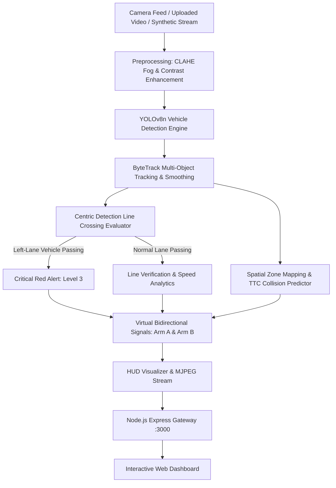

# # hairpin_detection-
# YOLO-Based Hairpin Bend Traffic Monitoring & Predictive Accident Prevention System

An intelligent, full-stack computer vision and deep learning traffic monitoring system engineered specifically for **blind hairpin bends, ghat sections, and high-risk mountain curves**.

---

## 📌 Project Overview

On mountainous ghat roads, steep cliffs, dense foliage, and sharp curvature restrict line-of-sight for oncoming traffic. Head-on collisions and blind-spot side-swipes frequently occur when heavy commercial vehicles (trucks and buses) swing wide or overtake across the opposing lane.

This system provides a real-time AI surveillance, trajectory tracking, and early warning pipeline:
* **Real-time Vehicle Detection (YOLOv8n)**: Detects cars, motorcycles, buses, and commercial heavy trucks.
* **Multi-Object Tracking (ByteTrack)**: Maintains persistent vehicle tracking IDs, estimates instantaneous speed (km/h), and maps directional trajectory vectors.
* **Adjustable Centric Detection Line (Virtual Trigger Line)**: Configurable horizontal trigger line (20%–80% Y-axis) for bidirectional vehicle passing verification.
* **Left Lane Passing & Critical Red Alert**: Dedicated monitoring for left-lane vehicles. When a vehicle crosses the centric trigger line in the left lane, the system triggers an emergency **Level 3 Red Alert**, pulsing visual perimeter warnings, and synchronized stop signals.
* **Collision Risk Prediction**: Evaluates spatial zones (Arm A: Uphill, Arm B: Downhill, Apex Conflict Zone) with Time-to-Conflict (TTC) calculations.
* **Synchronized Dual Traffic Signals**: Bidirectional signal indicators (Signal A and Signal B) enforcing mountain right-of-way protocols.
* **Modern Node.js & Express Frontend**: Clean, high-contrast dashboard with live video streaming, scanning effects, metrics, and incident logging.

---

## 🏗️ System Architecture & Workflow



---

## ⚙️ Methodology & Technical Implementation

### 1. Vision & Detection Pipeline
* **YOLOv8n Optimization**: Tailored confidence thresholds (`conf=0.18`) and multi-class mapping (`car`, `motorcycle`, `bus`, `truck`, and heavy trailer haulers) ensure reliable detection even for oblique, distant, or tarp-covered commercial trucks.
* **Heavy Vehicle Promotion**: Spatial footprint heuristics promote large commercial vehicles (`area >= 18,000 px^2`) to `truck` status with distinct high-visibility amber badges.
* **CLAHE Preprocessing**: Contrast-Limited Adaptive Histogram Equalization mitigates mountain shadows, sudden glare, and morning fog.

### 2. Tracking & Trajectory Estimation
* **Custom ByteTrack Profile**: Configured with lowered `new_track_thresh` (0.20) and `track_high_thresh` (0.20) with fallback trajectory tracking to eliminate vehicle dropouts on sharp turns.
* **Temporal Smoothing**: Rolling 4-frame bounding box queue eliminates bounding box jitter and flickering.
* **Speed Calculation**: Displacements mapped to calibrated real-world meters per second converted to km/h.

### 3. Centric Detection Line & Left Lane Red Alert
* **Virtual Trigger Line**: Adjustable horizontal trigger line rendered on the video stream.
* **Bidirectional Counter**: Tracks uphill (Arm A) and downhill (Arm B) crossings.
* **Left Lane Red Alert Engine**: Evaluates whether a passing car is occupying the left roadway lane (`cx <= 50% width`). If a left-lane vehicle intersects or crosses the centric line:
  - Centric line transitions to glowing **Pulsing Red (`#ef4444`)**.
  - Bounding box renders with double-bordered red badge: `[RED ALERT | LEFT PASSING]`.
  - The UI triggers an emergency flashing banner: `🚨 CRITICAL RED ALERT: LEFT PASSING CAR ON CENTRIC LINE!`.
  - Signal A and Signal B immediately illuminate **`RED - STOP`**.

---

## 📂 Project Directory Structure

```
hairpin_detection/
├── config/
│   └── config.yaml                     # Zone polygons, TTC thresholds, detection parameters
├── data/
│   ├── sample_videos/                  # Sample test images and synthetic videos
│   ├── snapshots/                      # Incident snapshot archives
│   ├── uploaded_videos/                # User uploaded video storage
│   └── logs/                           # SQLite database & CSV logs
├── public/                             # Frontend web dashboard (HTML5, CSS3, ES6)
│   ├── index.html                      # Single-page dashboard UI
│   ├── style.css                       # High-contrast stylesheet & animations
│   └── app.js                          # Real-time telemetry, upload & WebSocket/polling
├── src/                                # Core Python AI modules
│   ├── capture/video_stream.py         # Video ingestion & looping
│   ├── detection/yolo_detector.py      # YOLOv8n detector with heavy vehicle promotion
│   ├── tracking/tracker.py             # ByteTrack tracker with low-threshold profile
│   ├── risk_assessment/collision_predictor.py # TTC conflict prediction engine
│   ├── warning/visualizer.py           # HUD renderer, centric line & alert styling
│   ├── logging_storage/event_logger.py # SQLite & CSV persistence
│   ├── preprocessing/preprocessor.py   # CLAHE contrast filter
│   └── utils/synthetic_feed.py         # Procedural simulation generator
├── tests/                              # Automated test suite (21 unit & integration tests)
├── backend_service.py                  # FastAPI Python AI backend (:8000)
├── server.js                           # Node.js Express Gateway server (:3000)
├── package.json                        # Node dependencies & scripts
├── requirements.txt                    # Python dependencies
└── README.md                           # Documentation
```

---

## 🚀 Setup & Installation Guide

### Prerequisites
* **Python**: 3.10 or 3.11
* **Node.js**: v18+ (tested on v20–v26)
* **Git**

### Step 1: Clone the Repository
```bash
git clone https://github.com/shahiilr06/hairpin_detection-.git
cd hairpin_detection-
```

### Step 2: Install Python Dependencies
```powershell
pip install -r requirements.txt
```

### Step 3: Install Node.js Dependencies
```powershell
npm install
```

---

## 🖥️ Running the System

### Full-Stack Launch (Node.js + Python AI Engine)
Run the unified startup command:
```powershell
npm start
```

* **Frontend Dashboard**: Open your browser at **`http://localhost:3000`**
* **Python AI Backend**: Automatically spawned at **`http://127.0.0.1:8000`**

### Usage Instructions:
1. **Live Video Stream**:
   - Navigate to the **Live Video Stream** tab on the left sidebar.
   - Click **"Upload Video File"** to upload any traffic video (`.mp4`, `.avi`, `.mov`).
   - Adjust the **Centric Line Position (Y-Axis)** slider to match the road apex or trigger point.
   - Toggle **Left Lane Mode** (`ALL LANES` vs `ONLY LEFT`) to monitor left-lane overtaking hazards.
2. **Image Detection**:
   - Upload any roadway photo to inspect bounding boxes, confidence ratings, and spatial HUD overlays.
3. **Event Logs**:
   - Review historical incident records and telemetry snapshots stored in SQLite.

---

## 🧪 Automated Testing

Execute the complete pytest test suite:
```powershell
python -m pytest tests/ -v
```

All 21 automated unit and integration tests verify:
* YOLOv8n detector sensitivity and heavy truck promotion
* ByteTrack multi-object tracking and speed estimation
* Collision risk TTC calculations and signal state transitions
* Centric line crossing counts and left-lane red alert telemetry
* Defensive error handling and SQLite event logging

---

## 📜 License

This project is licensed under the MIT License.
