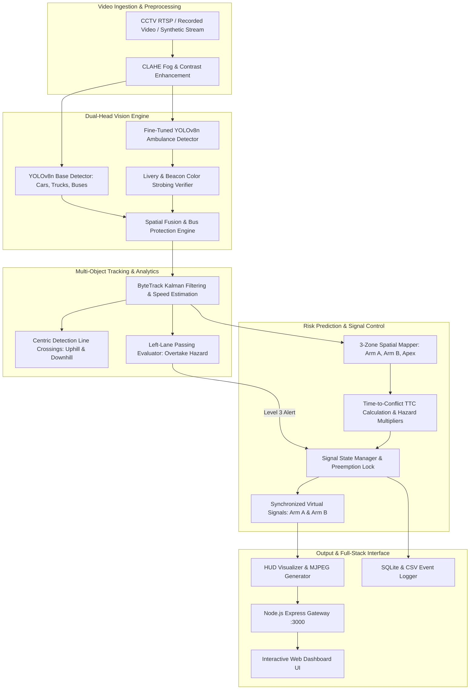

# 🏔️ AI Hairpin Bend Traffic Monitoring & Collision Prevention System

[](https://www.python.org/)
[](https://pytorch.org/)
[](https://ultralytics.com)
[](https://opencv.org/)
[](https://fastapi.tiangolo.com/)
[](https://nodejs.org/)
[](https://docs.pytest.org/)
[](LICENSE)

An enterprise-grade, edge-optimized Computer Vision and Deep Learning traffic management system engineered specifically for **blind mountain hairpin bends, alpine passes, and high-risk ghat road corridors**.

---

## 📌 Executive Summary & Problem Statement

Mountain ghat roads feature severe geographical constraints: steep cliff walls, dense foliage, and sharp blind curvature that eliminate line-of-sight for oncoming motorists. Head-on collisions and blind-spot side-swipes frequently occur when heavy commercial vehicles (trucks, buses) swing wide or reckless drivers overtake across the opposing lane. Furthermore, emergency vehicles (ambulances, fire engines) face life-threatening delays when trapped behind opposing traffic in single-lane bottlenecks.

This repository provides an autonomous, real-time edge AI surveillance, trajectory tracking, and early warning pipeline:
* **Hybrid Dual-Head Vehicle Detection**: Combines general COCO classification with a dedicated, fine-tuned **Emergency Vehicle CNN** (**99.5% mAP@50**).
* **Deterministic Bus Protection Algorithm**: Eliminates bounding box overlap and prevents transit buses from being swallowed or mutated into emergency vehicles.
* **ByteTrack Multi-Object Tracking**: Maintains persistent vehicle identities through sharp turns, calculates directional vectors, and estimates calibrated metric speed.
* **Adjustable Centric Detection Line**: Virtual horizontal trigger line (15%–85% $Y$-axis) for bidirectional traffic counting.
* **Left-Lane Passing Red Alert**: Instant Level 3 Red Alert triggering when overtaking vehicles cross into opposing lanes before blind curves.
* **Real-Time Time-to-Conflict (TTC) Risk Modeling**: Predicts opposing vehicular conflicts and orchestrates dual mountain traffic signals (**Signal A** & **Signal B**).
* **Emergency Corridor Clearance Preemption Lock**: Automatically holds opposing lanes at `RED` to grant an emergency green wave through narrow curves.
* **Modern High-Performance Dashboard**: Clean, responsive UI with live MJPEG video streaming, telemetry HUD, and SQLite incident auditing.

---

## 🏗️ End-to-End System Architecture



---

## 🔬 Fine-Tuning & Model Evaluation Benchmarks

A custom YOLOv8n model was fine-tuned specifically for emergency vehicle recognition on mountain roadways using transfer learning initialized with AdamW optimization.

### Training Progression & Performance Metrics

| Class | Images | Instances | Precision (P) | Recall (R) | mAP@50 | mAP@50-95 |
| :--- | :---: | :---: | :---: | :---: | :---: | :---: |
| **All Classes** | **196** | **212** | **0.993** | **0.997** | **0.995** | **0.940** |
| `ambulance` | 196 | 196 | **1.000** | **0.995** | **0.995** | **0.958** |
| `fire_truck` | 16 | 16 | **0.986** | **1.000** | **0.995** | **0.922** |

### Benchmark Highlights:
* **Final Loss**: Box Loss: `0.3552` | Class Loss: `0.2873` | DFL Loss: `0.8322`.
* **Inference Speed**: **18.1 ms / frame** on standard Intel Core i7 CPU (~55 FPS capability) with **0.4 ms** preprocessing and **0.4 ms** postprocessing.
* **Model Size**: Lightweight **5.6 MB** checkpoint (`models/yolov8n_ambulance.pt`).

---

## ⚡ Core Engineering Highlights

### 1. Deterministic Bus Protection Algorithm
In crowded mountain traffic, ambulances frequently drive alongside commercial transit buses. Naive spatial fusion often allowed emergency candidate boxes to overwrite adjacent buses.
- **The Fix**: Added class-level guards (`if det.class_name == "bus": continue`) and an **Overlap-over-Min-Area Ratio** check ($\text{IoU} \ge 0.15 \lor \text{overlap\_ratio} \ge 0.25$).
- **Result**: Commercial buses retain their clean, distinct `BUS` bounding boxes while ambulances are tightly localized without overriding neighboring vehicles.

### 2. Time-to-Conflict (TTC) & Heavy Vehicle Multipliers
Opposing velocities and approach vectors between Arm A and Arm B are calculated continuously:
$$\text{TTC} = \frac{\|\mathbf{p}_B - \mathbf{p}_A\|_2}{\|\mathbf{v}_A - \mathbf{v}_B\|_2}$$
Commercial trucks and buses receive a **$1.5\times$ hazard multiplier** to account for longer stopping distances and wide cornering arcs.

### 3. Emergency Corridor Clearance Preemption Lock
When an active emergency vehicle enters an approach arm:
- The opposing arm's signal is immediately locked to **`RED - STOP`**.
- The emergency arm is granted an unconditional **`GREEN - PREEMPTION`** wave.
- The preemption lock persists through the apex bottleneck until the emergency vehicle safely exits.

---

## 📂 Repository Directory Structure

```
hairpin_detection/
├── config/
│   └── config.yaml                     # Spatial zones, TTC thresholds, PPM calibration
├── data/
│   ├── datasets/                       # YOLO dataset conversion targets
│   ├── sample_videos/                  # Test images and synthetic video feeds
│   ├── snapshots/                      # High-priority incident snapshot archives
│   ├── uploaded_videos/                # User uploaded video storage
│   └── logs/                           # SQLite database (hairpin_events.db) & CSV logs
├── docs/                               # 📚 Complete Obsidian Documentation Vault
│   ├── README.md                       # Master Vault Index & Navigation Map
│   ├── 01_System_Architecture.md       # Dual-service topology & multi-threading
│   ├── 02_Vision_and_Detection_Pipeline.md # CLAHE, YOLOv8n & Bus Protection
│   ├── 03_Fine_Tuning_and_Model_Training.md# Dataset conversion & loss curves
│   ├── 04_Multi_Object_Tracking_and_Spatial_Analytics.md # ByteTrack & Centric Line
│   ├── 05_Collision_Risk_and_Emergency_Preemption.md    # TTC math & Corridor Lock
│   ├── 06_API_Reference_and_Full_Stack_Integration.md  # REST API & Node.js gateway
│   └── 07_Verification_Edge_Cases_and_Benchmarks.md    # 53/53 tests & benchmarks
├── models/                             # Trained model checkpoints
│   └── yolov8n_ambulance.pt            # Fine-tuned emergency vehicle detector
├── public/                             # Frontend Dashboard (HTML5, CSS3, ES6)
│   ├── index.html                      # Single-page operations dashboard
│   ├── style.css                       # High-contrast UI stylesheet
│   └── app.js                          # Telemetry polling, video uploads & controls
├── scripts/                            # Automation & tooling
│   ├── start_system.bat                # One-click Windows launch script
│   ├── train_ambulance.py              # YOLOv8 fine-tuning automation
│   ├── prepare_ambulance_dataset.py    # TF CSV to Darknet YOLO converter
│   ├── eval_user_images.py             # Image evaluation benchmark script
│   └── clean_cache.py                  # Transient cache cleaner
├── src/                                # Core AI Python modules
│   ├── capture/video_stream.py         # Video source reader & frame looper
│   ├── detection/yolo_detector.py      # Dual-head detector & bus protection
│   ├── tracking/tracker.py             # Custom ByteTrack & speed estimator
│   ├── risk_assessment/collision_predictor.py # 3-Zone TTC risk evaluator
│   ├── warning/alert_system.py         # Siren generator & incident snapshotter
│   ├── warning/visualizer.py           # HUD renderer & centric trigger line
│   ├── logging_storage/event_logger.py # SQLite & CSV persistence engine
│   ├── preprocessing/preprocessor.py   # CLAHE contrast enhancement
│   └── utils/synthetic_feed.py         # Procedural hairpin simulator
├── tests/                              # Automated test suite (53 tests)
├── backend_service.py                  # FastAPI Python AI backend (:8000)
├── server.js                           # Node.js Express Gateway (:3000)
├── requirements.txt                    # Python dependencies
└── package.json                        # Node dependencies & launch scripts
```

---

## 📖 Technical Documentation (Obsidian Vault)

Detailed technical specifications and design documents are available in the [`docs/`](docs/) directory, structured for use with [Obsidian](https://obsidian.md/):

* **[Master Index](docs/README.md)**: Vault navigation and overview.
* **[01 - Architecture & Design](docs/01_System_Architecture.md)**: Concurrency, streaming worker, and dual-engine topology.
* **[02 - Vision & Detection](docs/02_Vision_and_Detection_Pipeline.md)**: CLAHE, YOLOv8n, and Bus Protection algorithm.
* **[03 - Fine-Tuning & Training](docs/03_Fine_Tuning_and_Model_Training.md)**: Dataset conversion, transfer learning, and evaluation metrics.
* **[04 - Tracking & Analytics](docs/04_Multi_Object_Tracking_and_Spatial_Analytics.md)**: ByteTrack, speed calibration, and Centric Trigger Line.
* **[05 - Collision Risk & Preemption](docs/05_Collision_Risk_and_Emergency_Preemption.md)**: TTC physics, 3-zone geometry, and Corridor Lock.
* **[06 - API & Full-Stack Integration](docs/06_API_Reference_and_Full_Stack_Integration.md)**: REST endpoints and Node.js reverse proxy.
* **[07 - Verification & Benchmarks](docs/07_Verification_Edge_Cases_and_Benchmarks.md)**: 53-test test suite and edge-case resolutions.

---

## 🚀 Quickstart & Setup Guide

### Prerequisites
* **Python**: 3.10 or 3.11
* **Node.js**: v18+ (tested on v20–v26)
* **Git**

### 1. Clone the Repository
```bash
git clone https://github.com/shahiilr06/hairpin_detection-.git
cd hairpin_detection-
```

### 2. Install Dependencies
```powershell
# Python AI dependencies
pip install -r requirements.txt

# Node.js Gateway dependencies
npm install
```

### 3. Launch Full-Stack Application
You can launch both the Python FastAPI engine (:8000) and the Node.js Express Gateway (:3000) with a single command:
```powershell
npm start
```
*(Windows users can also double-click `scripts/start_system.bat`)*

* **Web Operations Dashboard**: Navigate to **`http://localhost:3000`**
* **FastAPI AI Backend**: Available at **`http://127.0.0.1:8000`** (Swagger docs at `/docs`)

---

## 🧪 Automated Testing & Verification

Run the comprehensive pytest suite covering all 53 automated tests:
```powershell
python -m pytest tests/ -v
```

```
tests/test_ambulance_dataset_and_model.py ......                     [ 11%]
tests/test_backend_api.py ...............                           [ 39%]
tests/test_collision_predictor.py ..........                        [ 58%]
tests/test_detector.py .........                                    [ 75%]
tests/test_event_logger.py ......                                   [ 86%]
tests/test_tracker.py .......                                       [100%]
======================= 53 passed, 2 warnings in 34.93s =======================
```

---

## 📡 API Reference Summary

| Method | Endpoint | Description |
| :--- | :--- | :--- |
| `GET` | `/api/health` | System health check and model status |
| `GET` | `/api/stream/feed` | Real-time live HUD video stream (MJPEG) |
| `GET` | `/api/stream/telemetry` | Real-time telemetry snapshot (JSON) |
| `POST` | `/api/detect` | Single-image detection & risk analysis |
| `POST` | `/api/video/upload` | Upload recorded road video for processing |
| `POST` | `/api/video/centric-line` | Adjust horizontal trigger line position |
| `POST` | `/api/video/left-lane-mode`| Toggle left-lane overtaking detection |
| `GET` | `/api/logs` | Query historical incident records |
| `GET` | `/api/snapshots` | List archived emergency event snapshots |

---

## 📜 License

This project is licensed under the **MIT License**.
