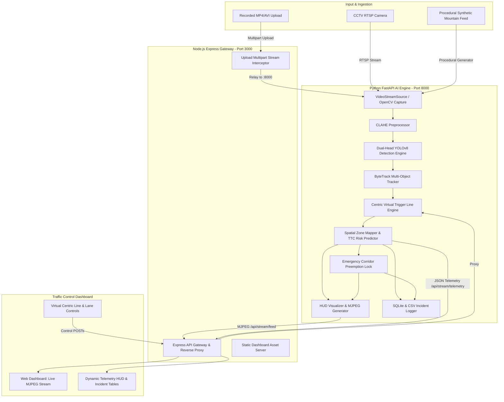
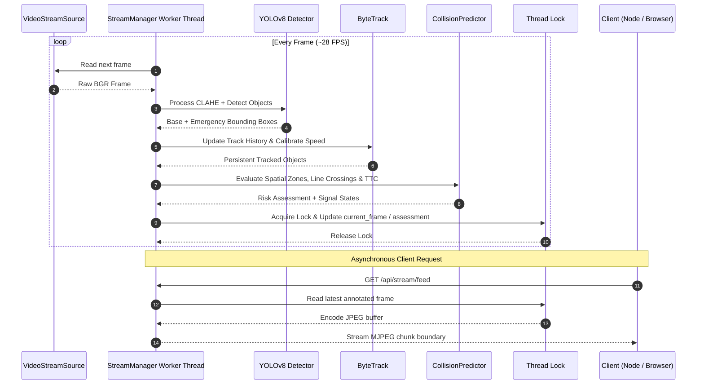

# 🏗️ 01 - System Architecture & Design

> [!NOTE] Architecture Objective
> Deliver deterministic, low-latency (<40ms per frame) computer vision inference and collision risk assessment on Edge and Cloud environments while serving a responsive, real-time UI dashboard to traffic operators.

---

## 1. High-Level System Architecture

The system decouples the **Heavy Compute Python AI Engine** from the **User-Facing Node.js Gateway & Web Dashboard**:

---

## 2. Dual-Engine Service Topology

### Why Decouple FastAPI and Node.js?

1. **GIL Isolation**: Python's Global Interpreter Lock (GIL) limits multi-threaded CPU concurrency. Keeping HTTP asset serving, file uploads, and browser client connections in Node.js prevents heavy client requests from starving the real-time vision inference pipeline.
2. **Edge Scalability**: The Python AI inference engine can be hosted on a dedicated GPU edge device (e.g., NVIDIA Jetson AGX Orin, AWS EC2 G4dn), while the Node.js gateway runs on an inexpensive lightweight server or container.
3. **Resilience**: If the video stream encounters a malformed frame or codec reset, the Node.js gateway handles reconnection gracefully without crashing or dropping browser sessions.

---

## 3. Multi-Threaded Streaming Architecture (`StreamManager`)

The backend implements a dedicated worker thread architecture within `backend_service.py` to decouple video frame acquisition from API request handling:

### Thread Safety & Natural Cadence Pacing

- **Mutex Synchronization (`threading.Lock`)**: The `_lock` protects `current_frame`, `current_assessment`, and `current_vehicles`. Readers (MJPEG streaming generator and telemetry polling endpoints) acquire the lock only for minimal memory copies (<0.2ms).
- **Controlled Playback Cadence**:
  $$\Delta t_{\text{sleep}} = \max\left(0.005\text{s},\, \frac{1}{\text{target FPS}} - \Delta t_{\text{processing}}\right)$$
  This guarantees smooth, natural video playback (~28 FPS) without runaway CPU loops or hyper-speed fast-forwarding during recorded file playback.

---

## 4. Hardware and Deployment Requirements

| Component | Minimum Specification | Recommended Production Spec |
| :--- | :--- | :--- |
| **CPU** | Intel Core i5 / AMD Ryzen 5 (4+ cores) | Intel Core i7 13th Gen / AMD Ryzen 7 |
| **GPU** | Integrated Graphics (CPU inference supported) | NVIDIA RTX 3060 / NVIDIA Jetson Orin Nano (4GB+) |
| **RAM** | 8 GB DDR4 | 16 GB DDR4/DDR5 |
| **OS** | Windows 10/11, Ubuntu 20.04/22.04 LTS | Ubuntu 22.04 LTS Server |
| **Network** | 100 Mbps Ethernet | 1 Gbps PoE Ethernet (for high-bitrate RTSP feeds) |

---

## 5. Next Chapter

Continue to [[02_Vision_and_Detection_Pipeline|Chapter 02 - Computer Vision & Detection Pipeline]] for the multi-stage detection architecture and bus protection mechanics.
