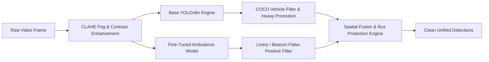
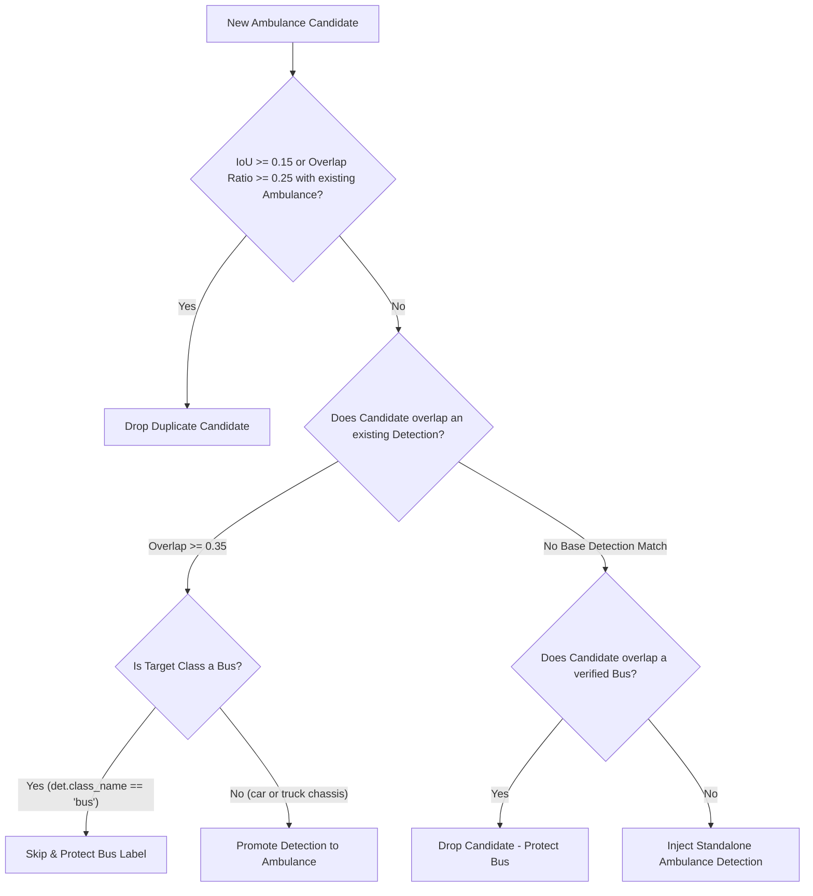

# 👁️ 02 - Vision & Detection Pipeline

> [!NOTE] Objective
> Implement a resilient dual-head detection architecture capable of identifying standard civilian vehicles, heavy commercial freight trucks, and emergency vehicles while eliminating false positives and bounding box collisions in dense alpine traffic.

---

## 1. Vision Pipeline Overview



---

## 2. Preprocessing: CLAHE Adaptive Enhancement

Mountain ghat roads suffer from adverse atmospheric conditions: morning fog, deep cliffside shadows, and sudden overexposure when rounding corners.

The pipeline applies **Contrast-Limited Adaptive Histogram Equalization (CLAHE)** on the luminance channel ($L$) in LAB color space:
```python
lab = cv2.cvtColor(frame, cv2.COLOR_BGR2LAB)
l_channel, a_channel, b_channel = cv2.split(lab)
clahe = cv2.createCLAHE(clipLimit=2.5, tileGridSize=(8, 8))
enhanced_l = clahe.apply(l_channel)
enhanced_lab = cv2.merge((enhanced_l, a_channel, b_channel))
proc_frame = cv2.cvtColor(enhanced_lab, cv2.COLOR_LAB2BGR)
```
- **Clip Limit (2.5)**: Prevents noise amplification in shaded asphalt regions.
- **Tile Grid ($8 \times 8$)**: Enhances local roadway contrast without altering vehicle color signatures.

---

## 3. Base YOLOv8n & Heavy Vehicle Promotion

Standard pre-trained YOLOv8n models can misidentify distant, oblique, or canvas-covered commercial trucks as standard passenger cars.

1. **Multi-Class COCO Targeting**:
   - Class 2: `car`
   - Class 3: `motorcycle`
   - Class 5: `bus`
   - Class 6 & 7: `truck` / heavy freight haulers
2. **Heavy Vehicle Footprint Heuristic**:
   Vehicles initially labeled `car` that exhibit large bounding box dimensions on roadway approach are promoted to `truck`:
   $$\text{Area} = W \times H \ge 22,000\,\text{px}^2 \quad \land \quad H \ge 115\,\text{px} \quad \land \quad \frac{H}{W} \ge 0.55$$
   This ensures heavy commercial haulers that require wide turning arcs are properly prioritized by the collision risk calculator.

---

## 4. Bus Protection Mechanism (Eliminating Override)

> [!CRITICAL] The Problem
> In high-density traffic (e.g. city transit buses alongside hospital emergency vans), emergency vehicle models can generate overlapping candidate boxes. If an ambulance candidate overlaps an adjacent passenger bus, a naive fusion step would rewrite the bus's label to `ambulance`, swallowing the bus.

### The Solution: Deterministic Bus Protection Algorithm



### Mathematical Formulation of Overlap Ratio

To catch partial enclosures and wide bounding boxes, the system evaluates both standard **Intersection-over-Union (IoU)** and **Intersection-over-Min-Area (Overlap Ratio)**:

$$\text{IoU}(A, B) = \frac{\text{Area}(A \cap B)}{\text{Area}(A \cup B)}$$

$$\text{OverlapRatio}(A, B) = \frac{\text{Area}(A \cap B)}{\min(\text{Area}(A), \text{Area}(B))}$$

- If $\text{IoU} \ge 0.15$ or $\text{OverlapRatio} \ge 0.25$ against an existing ambulance, the duplicate box is discarded.
- In `yolo_detector.py`, `if det.class_name == "bus": continue` guarantees that transit coaches (e.g., KSRTC, interstate buses) retain their clean, distinct bounding boxes.

---

## 5. False-Positive Emergency Vehicle Verification

To prevent civilian white passenger cars, vans, or SUVs from falsely triggering emergency alarms:
1. Candidate bounding boxes are passed to `classify_emergency_vehicle()`.
2. Evaluates HSV color masks for emergency flashing beacon strobes (red/blue) and ambulance crosses/stipes.
3. Civilian vehicles without emergency features are rejected before spatial fusion.

---

## 6. Next Chapter

Proceed to [[03_Fine_Tuning_and_Model_Training|Chapter 03 - Fine-Tuning & Model Training]] for the dataset conversion pipeline and training metrics.
