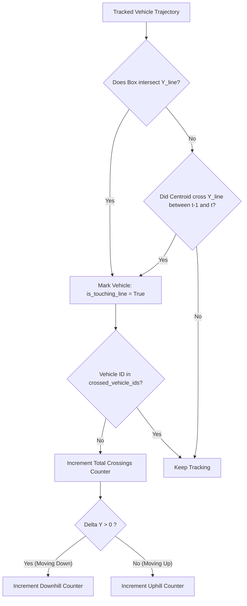
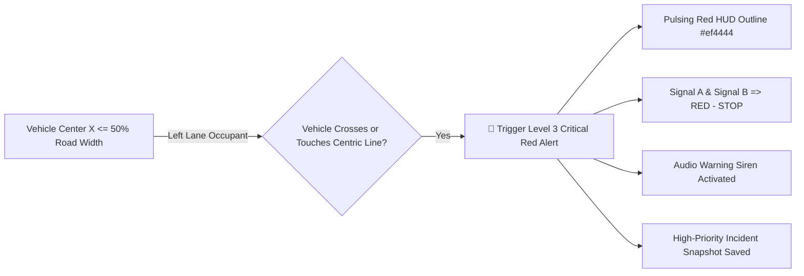

# 🛰️ 04 - Multi-Object Tracking & Spatial Analytics

> [!NOTE] Objective
> Transform raw, unlinked per-frame detections into persistent, trajectory-aware vehicle tracks with calibrated metric speed and directional vectors, powering the virtual centric trigger line.

---

## 1. Custom ByteTrack Integration

Standard object tracking often drops tracks during sharp mountain turns due to rapid aspect ratio shifts and occlusions.

The system uses a customized **ByteTrack** Kalman filter configuration (`src/tracking/tracker.py`):
- `track_high_thresh = 0.20`: Allows low-confidence detections from partially obscured vehicles to sustain active tracks.
- `new_track_thresh = 0.20`: Ensures oncoming vehicles entering around blind corners are tracked immediately.
- `track_buffer = 30`: Keeps track IDs alive across up to 30 dropped frames during severe obstruction.
- **Rolling Trajectory Queue**: Retains a 4-frame window to smooth bounding box jitter:
  $$\overline{\mathbf{B}}_t = \frac{1}{N} \sum_{i=0}^{N-1} \mathbf{B}_{t-i}$$

---

## 2. Metric Speed Estimation & Calibration

Vehicle speed is estimated by calculating centroid displacement across consecutive frames:

$$\Delta d_{\text{pixels}} = \sqrt{(c_{x, t} - c_{x, t-1})^2 + (c_{y, t} - c_{y, t-1})^2}$$

$$v_{\text{km/h}} = \left( \frac{\Delta d_{\text{pixels}}}{\text{PPM}} \times \text{FPS} \right) \times 3.6$$

* **Calibrated Scale (`PPM`)**: 18.0 pixels per meter (calibrated for standard 720p mountain roadway cameras).
* **Exponential Moving Average (EMA)**: Smooths instantaneous acceleration spikes caused by perspective projection:
  $$v_{\text{smoothed}} = 0.7 \cdot v_{\text{prev}} + 0.3 \cdot v_{\text{instant}}$$

---

## 3. Centric Detection Line & Bidirectional Crossing

A virtual trigger line is rendered horizontally across the roadway at an adjustable ratio:
$$Y_{\text{line}} = H_{\text{frame}} \times \text{ratio} \quad (0.15 \le \text{ratio} \le 0.85)$$

---

## 4. Left-Lane Passing & Critical Red Alert Engine

On right-hand drive mountain roads, overtaking on the inside or crossing into the opposing left lane before a blind corner is a frequent cause of fatal accidents.

- **Zone Partitioning**: $C_x \le 0.50 \cdot W_{\text{frame}}$ identifies left-lane occupancy.
- **Real-Time Override**: When an overtaking vehicle crosses the centric line in the left lane, the system immediately overrides signal states to **`RED - STOP`** in both directions to prevent oncoming traffic from rounding the corner.

---

## 5. Next Chapter

Proceed to [[05_Collision_Risk_and_Emergency_Preemption|Chapter 05 - Collision Risk & Emergency Preemption]] for the Time-to-Conflict algorithm and corridor clearance lock.
