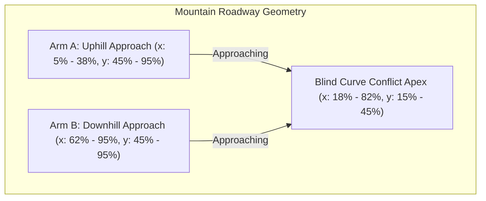
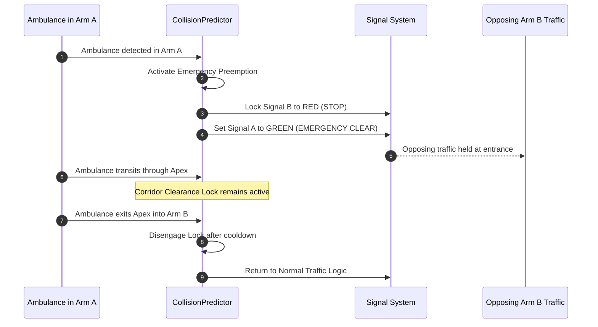

# ⚠️ 05 - Collision Risk & Emergency Preemption

> [!NOTE] Objective
> Implement real-time mathematical risk modeling (Time-to-Conflict) and emergency corridor preemption locks to coordinate bidirectional mountain signals and eliminate bottleneck crashes.

---

## 1. 3-Zone Mountain Geometry

The roadway is modeled into three normalized spatial polygons (`config/config.yaml`):

* **Point-in-Polygon (PIP) Matching**: Every tracked vehicle's ground contact point $\left(C_x, Y_{\max}\right)$ is mapped via `cv2.pointPolygonTest` to identify its current operational zone.

---

## 2. Time-to-Conflict (TTC) Risk Formulation

When vehicles occupy opposing arms (Arm A and Arm B) simultaneously or converge on the Apex:

$$\Delta \mathbf{p} = \mathbf{p}_B - \mathbf{p}_A, \quad \Delta \mathbf{v} = \mathbf{v}_A - \mathbf{v}_B$$

$$\text{TTC} = \frac{\|\Delta \mathbf{p}\|_2}{\max\left(0.1, \frac{\Delta \mathbf{p} \cdot \Delta \mathbf{v}}{\|\Delta \mathbf{p}\|_2}\right)}$$

### Hazard Multipliers for Heavy Vehicles

Heavy vehicles (trucks and commercial buses) require wider turning radiuses and longer braking distances:
* Standard Car / Motorcycle: $w = 1.0$
* Commercial Truck / Bus: $w = 1.5$

$$\text{Effective TTC} = \frac{\text{TTC}}{\max(w_A, w_B)}$$

### Risk Tier Escalation Matrix

| Level | State | TTC Threshold | Physical / Visual Signal Action |
| :---: | :---: | :---: | :--- |
| **0** | **SAFE** | $\text{TTC} > 10.0\,\text{s}$ | Both directions **GREEN** |
| **1** | **CAUTION** | $6.0\,\text{s} < \text{TTC} \le 10.0\,\text{s}$ | Arm with right-of-way **GREEN**; Opposing **YELLOW** |
| **2** | **WARNING** | $3.0\,\text{s} < \text{TTC} \le 6.0\,\text{s}$ | Heavy/uphill vehicle granted **GREEN**; Opposing **RED** |
| **3** | **CRITICAL** | $\text{TTC} \le 3.0\,\text{s}$ or Left Overtake | Both Signals **RED - STOP** + Audio Alarm Siren |

---

## 3. Emergency Corridor Clearance Preemption Lock

When an emergency vehicle (`ambulance` or `fire_truck`) is detected:

- **Persistence Guarantee**: If the emergency vehicle is momentarily occluded inside the apex curve, the corridor clearance lock maintains **`RED`** on opposing lanes until clear exit is verified.

---

## 4. Next Chapter

Proceed to [[06_API_Reference_and_Full_Stack_Integration|Chapter 06 - API Reference & Full-Stack Integration]] for endpoint contracts and system setup.
