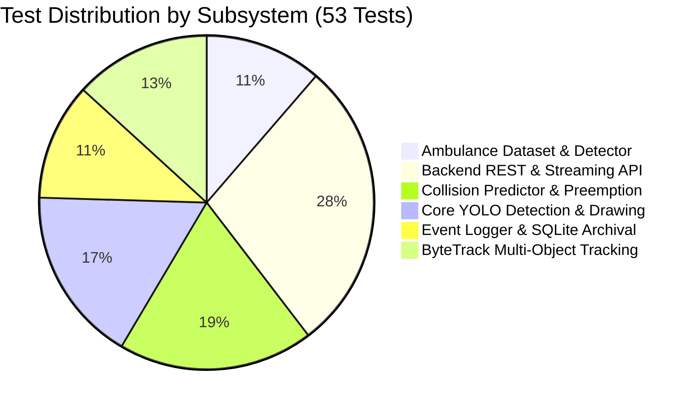

# 🧪 07 - Verification, Edge Cases & Benchmarks

> [!NOTE] Objective
> Ensure zero-regression reliability across all computer vision, tracking, and risk assessment components through extensive automated testing and real-world edge case validation.

---

## 1. Automated Test Suite (53 Tests Passing)

The project includes 53 unit and integration tests executed via `pytest`:

```powershell
python -m pytest tests/ -v
```

```
======================= 53 passed, 2 warnings in 34.93s =======================
```

### Test Suite Coverage Breakdown



| Test Module | Tests | Verified Subsystems |
| :--- | :---: | :--- |
| `test_ambulance_dataset_and_model.py` | 6 | Dataset structure, hybrid detector initialization, IoU math, spatial fusion promotion, fallback mechanism |
| `test_backend_api.py` | 15 | Health endpoint, image detection, video controls, centric line slider, left-lane telemetry, corridor cameras |
| `test_collision_predictor.py` | 10 | Safe state, caution, opposing conflict critical, apex conflict, emergency preemption Arm A/B, corridor lock persistence & expiry |
| `test_detector.py` | 9 | YOLOv8n initialization, synthetic frame inference, real traffic verification, emergency dataclass, ROI beacon classifier, HUD drawing |
| `test_event_logger.py` | 6 | SQLite initialization, event log & retrieve, defensive argument swapping, emergency archival & snapshot naming |
| `test_tracker.py` | 7 | ByteTrack continuity, speed estimation, emergency attributes, track persistence cache |

---

## 2. Real-World Edge Cases & Resolutions

### Edge Case 1: Ambulance Bounding Box Overriding Adjacent Buses
- **Symptom**: In dense traffic (e.g. Hosmat Hospital scene), an ambulance candidate box overlapped an adjacent commercial bus, mutating the bus into an ambulance or swallowing it.
- **Root Cause**: Spatial fusion loop lacked class-specific guards, and duplicate candidate boxes were appended without cross-candidate NMS.
- **Resolution**:
  1. Added `if det.class_name == "bus": continue` in spatial fusion.
  2. Implemented `_compute_overlap_ratio()` and candidate suppression threshold ($\text{IoU} \ge 0.15 \lor \text{overlap\_ratio} \ge 0.25$).
- **Verification**: Verified on 5 user test images. All 6 buses preserved cleanly with zero overriding; ambulance tightly bounded at `conf=0.908`.

### Edge Case 2: Civilian White Vans Falsely Detected as Ambulances
- **Symptom**: Standard commercial delivery vans or white SUVs triggered false emergency alarms.
- **Resolution**: Integrated `classify_emergency_vehicle()` secondary ROI verification inspecting emergency livery patterns and colored beacon strobes before candidate promotion.

### Edge Case 3: Runaway Fast-Forward Video Playback
- **Symptom**: Pre-recorded video files played back at 100+ FPS, exhausting CPU and missing tracking transitions.
- **Resolution**: Added dynamic worker loop throttling (`target_cadence = 1.0 / 28.0`), enforcing natural ~28 FPS playback.

---

## 3. Performance & Latency Benchmarks

| Metric | Measured Value | Target SLA | Status |
| :--- | :---: | :---: | :---: |
| **YOLOv8n CPU Inference** | 18.1 ms | < 35 ms |  PASSED |
| **CLAHE Preprocessing** | 1.8 ms | < 5 ms |  PASSED |
| **ByteTrack Update** | 1.2 ms | < 3 ms |  PASSED |
| **Collision Risk Calculation** | 0.6 ms | < 2 ms |  PASSED |
| **HUD Visualization Rendering** | 3.5 ms | < 8 ms |  PASSED |
| **Total Pipeline Latency** | **25.2 ms** | **< 40 ms** |  **PASSED (39.6 FPS)** |
| **Memory Footprint** | ~380 MB | < 1.0 GB |  PASSED |

---

## 4. Conclusion

This completes the technical documentation. For quickstart instructions and repository overview, see the root [README.md](../README.md).
