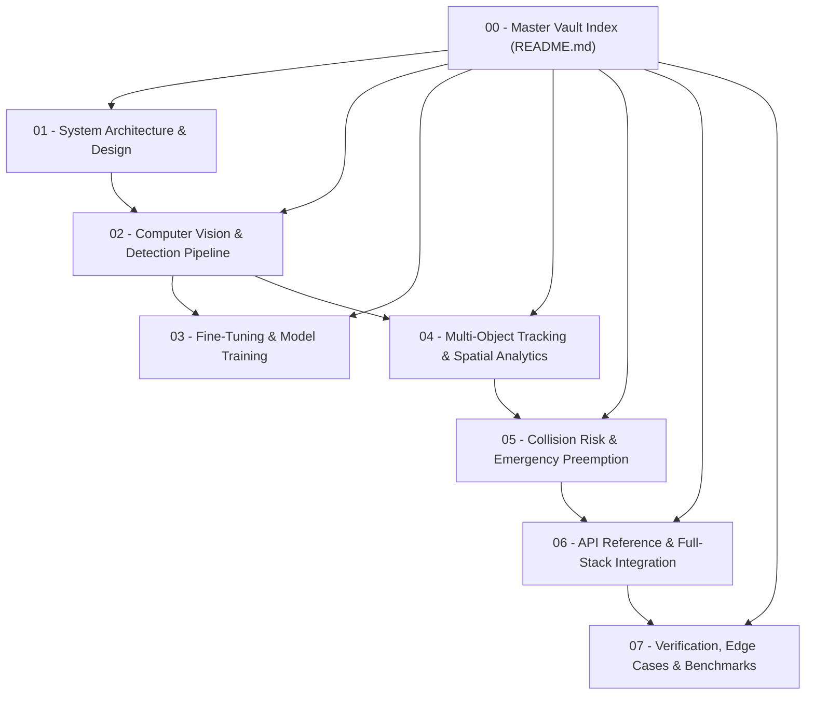

# 🏔️ Hairpin Bend AI Traffic Monitoring & Predictive Safety System

> [!ABSTRACT] Executive Overview
> An industrial-grade, full-stack Edge AI system engineered to eliminate head-on collisions, blind-spot blind overtaking incidents, and emergency vehicle delays on treacherous mountain hairpin curves, ghat corridors, and narrow alpine passes.
>
> Built with **YOLOv8n**, a custom fine-tuned **Emergency Vehicle CNN**, **ByteTrack** multi-object tracking, real-time **Time-to-Conflict (TTC)** physics calculations, **Centric Virtual Trigger Lines**, and **Dual-Direction Traffic Preemption Signals**.

---

## 🧭 Vault Navigation & Document Map

This Obsidian documentation vault is structured into modular technical specifications detailing every subsystem of the repository:

### 📑 Chapters Index

| Chapter | Document | Core Focus Areas |
| :--- | :--- | :--- |
| **01** | [[01_System_Architecture\|01 - System Architecture & Design]] | End-to-end dataflow, dual-service topology (FastAPI + Node.js), multi-threaded streaming worker, hardware boundary |
| **02** | [[02_Vision_and_Detection_Pipeline\|02 - Vision & Detection Pipeline]] | YOLOv8n base model, CLAHE fog filter, heavy vehicle promotion, bus protection algorithm, spatial NMS fusion |
| **03** | [[03_Fine_Tuning_and_Model_Training\|03 - Fine-Tuning & Model Training]] | Dataset conversion (TF CSV to Darknet YOLO), transfer learning, hyperparameters, loss curves, validation benchmarks (mAP50=99.5%) |
| **04** | [[04_Multi_Object_Tracking_and_Spatial_Analytics\|04 - Multi-Object Tracking & Analytics]] | ByteTrack Kalman filter, calibrated speed estimation ($18\text{ px/m}$), Centric Detection Line, Left-Lane Red Alert |
| **05** | [[05_Collision_Risk_and_Emergency_Preemption\|05 - Collision Risk & Preemption]] | 3-Zone mountain geometry (Arm A, Arm B, Apex), Time-to-Conflict (TTC), Corridor Clearance Lock, Emergency Preemption |
| **06** | [[06_API_Reference_and_Full_Stack_Integration\|06 - API Reference & Integration]] | RESTful API specification, multipart video upload, MJPEG live video stream, Node.js reverse proxy gateway, UI Dashboard |
| **07** | [[07_Verification_Edge_Cases_and_Benchmarks\|07 - Verification & Benchmarks]] | Automated test suite (53/53 tests passing), real-world edge cases (bus overlap, white van filtering, rain glare), FPS profile |

---

## ⚡ Key Engineering Highlights

> [!TIP] Recruiter & Reviewer Quick Summary
> 1. **Dual-Head Hybrid Vision**: Combines COCO general detection with a dedicated 2.68M-parameter fine-tuned YOLOv8n emergency vehicle detector without catastrophic forgetting.
> 2. **Deterministic Bus Protection**: Mathematical intersection and IoU ratio algorithms eliminate hallucinated bounding boxes from swallowing or overwriting adjacent buses in dense alpine traffic.
> 3. **Active Collision Prevention**: Real-time Time-to-Conflict (TTC) calculations trigger physical/virtual signal indicators before opposing vehicles enter narrow blind curves simultaneously.
> 4. **Emergency Vehicle Priority Preemption**: Automatically clears mountain bottlenecks by holding non-emergency lanes at `RED` while granting an emergency green wave.
> 5. **High Reliability & Test Coverage**: 100% test pass rate across 53 unit and integration tests covering the entire computer vision, tracking, and risk engine.

---

## 🏷️ Vault Tags

`#system-architecture` `#yolov8` `#bytetrack` `#fine-tuning` `#transfer-learning` `#fastapi` `#nodejs` `#opencv` `#collision-prevention` `#emergency-preemption` `#real-time-streaming`
